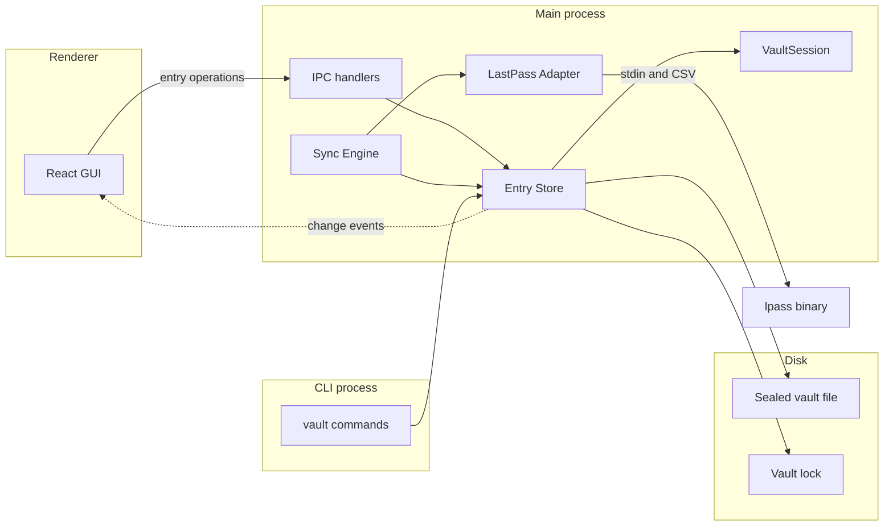
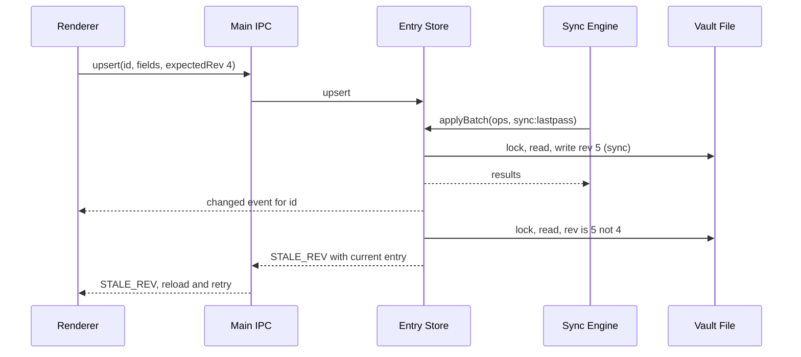
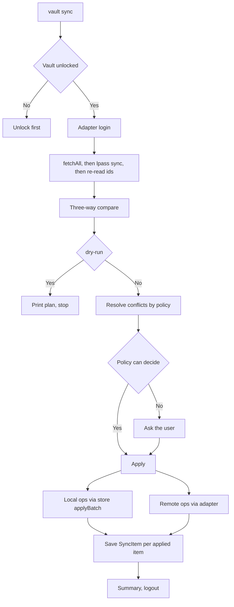

# RFC: provider sync (LastPass first) on a granular entry store

| Field     | Value                                                                                                                 |
| --------- | --------------------------------------------------------------------------------------------------------------------- |
| Status    | **Draft**: open questions in §13 need decisions before step 2                                                         |
| Date      | 2026-10-25                                                                                                            |
| Strategy  | C, staged in three releases (see §10)                                                                                 |
| Builds on | [`NATIVE-HELPER-RFC.md`](../environments/NATIVE-HELPER-RFC.md) (format features), `src/electron/utils/vaultFormat.js` |
| Next RFC  | `browser-extension`, which reuses the store API from §5                                                               |

## 1. Summary

The vault should stay in step with LastPass for the long term, without ever
losing data. Today it cannot: the vault has no entry history, no delete
tombstones and no record of the last synced state, and every save replaces the
whole vault.

This RFC proposes three things, shipped as three separate releases:

1. **Fix the save path** so settings, master-password history and unknown
   fields survive a save, and confirm the format-feature gate (§10, step 1).
2. **A granular entry store** in the main process: entry-level operations with
   a stable `uid`, a `rev` counter, per-entry version history and tombstones.
   The GUI, CLI and later the extension all write through it (§5–§7, step 2).
3. **A two-way sync engine** with a provider-adapter interface and a LastPass
   adapter that shells out to `lpass` (§8–§9, step 3).

## 2. Where the code stands today

Read from the code, not assumed:

- **One write path, whole-vault.** The renderer (`PasswordManager.jsx`,
  `saveVaultData`) sends `{version, created, entries}` to the `save-vault`
  handler (`public/main.js`), which passes it straight to
  `VaultService.saveVault(name, credential, data)`. `Vault.toJSON()` writes a
  fixed field list.
- **Verified by probe (2026-10-25, throwaway vault, service level).** A save
  shaped like the GUI's reset `settings` (a `maxPasswordHistory` of 9 became
  the default 3), emptied `passwordHistory`, lost a custom setting and dropped
  an unknown top-level field. The end-to-end GUI symptom has not been clicked
  through.
- **Entries** are a map keyed by `id`. IDs are `Date.now().toString()`,
  generated in the renderer: millisecond timestamps, collision-prone for bulk
  imports, and not an identity another system can rely on.
- **Settings** live in the payload (`Vault._validateSettings` keeps unknown
  keys) and have an `update-vault-settings` IPC.
- **Format gating exists.** `VAULT_FORMATS` in `vaultFormat.js` lists optional
  `features`; a tool that meets a feature it does not know may read the vault
  but must not write it.
- **The unlocked credential** lives in `VaultSession` in the main process, with
  a 5-minute idle lock; the renderer never keeps it.
- **The CLI** (`bin/cli.js`) has `info`, `recover` and `env` commands only. It
  cannot list, edit or sync password-vault entries.
- **The agent daemon** serves env vaults only and is request-scoped by design;
  it is not part of this design.

## 3. Goals and non-goals

### Goals

1. A sync never loses data: every value it overwrites and every entry it
   deletes is restorable from history.
2. `vault sync --dry-run` reports exactly what a real sync then does.
3. Conflicts (edit/edit and delete/edit) follow a per-vault policy; when the
   policy cannot decide, the user is asked.
4. An interrupted or failed sync leaves both sides consistent and resumable.
5. Old vaults open and upgrade without loss, and older tools never silently
   drop history.
6. Concurrent writers (GUI, CLI, sync) cannot overwrite each other.

### Non-goals

- Providers other than LastPass. The interface (§8.1) must allow them; nothing
  more is built.
- Attachments (the vault has none; `lpass` can only read them).
- Background or scheduled sync. Sync is manual: `vault sync` and a GUI button.
- Syncing `otp`, `gpg_key` and `level3_card` entries. They are skipped and
  carry a "not synced" label in the list and the detail view.
- The browser extension (its own RFC), and MFA types other than TOTP beyond
  failing clearly.

## 4. Architecture



The store is a module, not a service: the Electron main process and the CLI
both import it and open the same sealed file, so cross-process safety comes
from the file lock (§5.3), not from the process boundary.

**Honest note on "granular".** The file is still one sealed blob, so every
store operation reads, changes and re-seals the whole payload. Granularity is
in the API and the concurrency model, not in storage. A sync that changes 200
entries is one batch and one write.

## 5. The entry store

### 5.1 Data schema (payload)

New fields are added to the existing payload. `entries` holds **live entries
only**, so an older reader sees a correct vault; versions and tombstones live
in a separate `history` map.

```text
payload = {
  version, created, lastPasswordChange, passwordHistory, isDefault,   // unchanged
  entries: { [id]: Entry },            // live entries; id is the existing key
  settings: { ...existing, history: HistorySettings, sync: SyncSettings },
  history: { [id]: EntryHistory },     // new, feature "history"
  sync:    { providers: { [providerId]: ProviderState } }   // new, feature "sync"
}

Entry         = { id, uid, rev, entryType, ...typed fields, createdAt, updatedAt }
EntryHistory  = { uid, versions: Version[], tombstone?: Tombstone }
Version       = { rev, at, reason, source, snapshot, protected? }
  reason      = "edit" | "delete" | "sync" | "restore" | "import"
  source      = "gui" | "cli" | "extension" | "sync:lastpass"
  snapshot    = the Entry as it was, without `versions`
Tombstone     = { at, rev, source }    // the entry is removed from `entries`

HistorySettings = { maxVersions, maxAgeDays }       // per vault, retention
SyncSettings    = { conflictPolicy, deleteVsEdit }  // per vault, see §9.3
ProviderState   = { account, lastSyncAt, items: { [remoteId]: SyncItem } }
SyncItem        = { entryId, uid, baseRev, remoteHash, remoteModified }
```

- `uid` is a UUID assigned on first write (or at migration) and never changes;
  `id` stays as the map key, so no key is rewritten.
- `rev` starts at 1 and increases on every write to that entry, including
  restore.
- `protected` marks a version that retention must not prune: a version that a
  `SyncItem.baseRev` points at, and any version created by a sync resolution
  until the user has seen the sync summary (§9.3).

### 5.2 Operations

```text
get(id) / list()
upsert(id | null, fields, { expectedRev?, source }) -> { entry }
delete(id, { expectedRev?, source })                -> { tombstone }
restoreVersion(id, rev, { source })                 -> { entry }
restoreDeleted(uid, { source })                     -> { entry }
history(id) / deletedEntries()
applyBatch(ops, { source })                         -> { results }   // one atomic write
getSettings() / updateSettings(patch)
```

Rules:

1. **Snapshot on overwrite or delete.** `upsert` snapshots the prior entry when
   it changes or removes any field that had a value. A save that only adds data
   to empty fields does not snapshot. `delete` always snapshots and writes a
   tombstone. This holds whatever the caller.
2. **Optimistic concurrency.** If `expectedRev` is given and differs from the
   stored `rev`, the call fails with `STALE_REV` and returns the current entry.
   Callers that cannot supply it (import) pass `source: "import"` and get a
   snapshot of whatever they replace.
3. **Read-modify-write under the lock.** Every operation takes the vault lock,
   re-reads the sealed file, applies the change and writes, so it never
   overwrites a change it has not read. The lock is `VaultLock.js`; step 2
   confirms it serializes writers across the GUI and CLI processes.
4. **Retention.** Applied on write, per vault, never pruning `protected`
   versions.

### 5.3 Events and the renderer

The store emits `changed { vaultName, ids, source }`. The main process forwards
it to the renderer (a preload `onVaultChanged`), and the GUI reloads the
affected entries. The renderer no longer holds the authoritative copy and no
longer sends whole vaults. The `save-vault` handler is removed at the end of
step 2.



## 6. Migration

- **Step 1** writes no new fields. It only fixes saves (§10).
- **Step 2** adds features `history` and `sync` to `VAULT_FORMATS.password`.
  On the first write by a step-2 build, an open vault is upgraded:
  1. A backup is taken (the existing `VaultFileService` backup, plus a
     dated copy kept until the next successful open).
  2. Every entry gains `uid` and `rev: 1`; `history` and `sync` are created
     empty; `settings.history` and `settings.sync` get defaults.
  3. The envelope lists the features it now uses.
- The upgrade is **per vault, on first write**, not on open, so merely opening
  a vault in a newer build does not change the file.
- A vault using these features opens read-only in a build that does not know
  them, with the existing upgrade hint (`UPGRADE_HINT`).
- A round-trip test on real vault files (old to new to read-back) gates the
  release.

## 7. History and recovery

- **GUI:** an entry's detail view lists its versions; restore creates a new
  `rev` from the chosen snapshot (it does not rewind). A trash view lists
  deleted entries (tombstones) with restore.
- **CLI (new):** `vault entries history <id>`, `vault entries restore <id>
<rev>`, `vault entries restore --deleted <uid>`.
- **Purge** of a single version is **not** in this RFC. The principle is that
  sync and automatic resolution are non-destructive; any purge would be a
  separate, explicit, confirmed action outside the sync path (§13).
- **Retention** is per vault (`maxVersions`, `maxAgeDays`). The default keeps
  everything until a limit is set.

## 8. Sync engine

### 8.1 Provider adapter interface

```text
SyncProvider {
  id: string
  login(credentials: () => Promise<{ password, mfaCode? }>) -> Session
  fetchAll(session)                  -> RemoteItem[]
  create(session, item)              -> { remoteId }
  update(session, remoteId, item)    -> void
  remove(session, remoteId)          -> void
  logout(session)
}

RemoteItem = { remoteId, folder, name, kind, fields, modified }
```

`credentials` is a callback so the engine never stores the master password; the
adapter asks for it at login and drops it. An adapter that cannot do something
(for example `create` for a type it cannot represent) throws a typed error the
engine reports per item.

### 8.2 Mapping

`mapper.toRemote(entry)` and `mapper.fromRemote(item)` are per entry type and
return `{ supported, lossy: string[] }`.

| Vault type                      | LastPass form       | Notes                                               |
| ------------------------------- | ------------------- | --------------------------------------------------- |
| `password`                      | site item           | title, username, password, url, notes               |
| `secure_note`                   | secure note         | content as the note body                            |
| `wifi`                          | typed note, Wi-Fi   | field names confirmed in the spike                  |
| `ssh_key`                       | typed note, SSH Key | field names confirmed in the spike                  |
| `bank_account`                  | typed note, Bank    | template fields not yet verified                    |
| `credit_card`                   | typed note, Credit  | template fields not yet verified                    |
| `otp`, `gpg_key`, `level3_card` | none                | skipped; "not synced" label in list and detail view |

- `category` maps to the LastPass folder.
- Typed notes return from `lpass` as plain secure notes whose body holds
  `Key:value` lines and whose field order can change; the mapper parses and
  renders them, and compares by field, not by text.
- The vault's entry types have fixed typed fields and no free-form custom
  fields today, so the lack of custom-field writes on LastPass logins does not
  lose data for the supported types.
- A skipped entry is invisible to sync: a LastPass item that happens to share
  its name is not a conflict (decision recorded; confirm in §13).

### 8.3 Sync state and the three-way compare

For each provider the vault stores a `SyncItem` per remote item: the matching
local `entryId` and `uid`, the local `baseRev` and the hash of the remote item
(canonical form) as of the last successful sync, plus the remote modified time
as a hint only.

For each pair the engine computes `localChanged` (`entry.rev != baseRev`) and
`remoteChanged` (hash of the fetched item differs from `remoteHash`):

| Local     | Remote    | Result                                       |
| --------- | --------- | -------------------------------------------- |
| unchanged | unchanged | nothing                                      |
| changed   | unchanged | push update                                  |
| unchanged | changed   | pull update                                  |
| changed   | changed   | merge or conflict (§9.3)                     |
| deleted   | unchanged | push delete                                  |
| unchanged | deleted   | pull delete (local delete, history keeps it) |
| deleted   | changed   | delete-versus-edit (§9.3)                    |
| changed   | deleted   | delete-versus-edit (§9.3)                    |
| new       | absent    | push create                                  |
| absent    | new       | pull create (new `uid`, new `id`)            |

Deletes are inferred, because LastPass keeps no tombstones: an item in state
but absent from the fetch is a remote delete, and a tombstone for an entry in
state is a local delete.

**First sync / lost state.** With no `SyncItem` for an account, the engine never
infers deletes. It matches items by (folder, name, type) and content hash,
treats unmatched items as creates in the direction they appear, and reports
ambiguous matches as conflicts.

### 8.4 Lifecycle



Apply is **item-by-item idempotent**: each applied item updates its `SyncItem`
immediately, so an interrupted sync resumes and a second run only does what is
left. Local changes go through `applyBatch` with `source: "sync:lastpass"`
(snapshotting everything they overwrite). Remote changes go through the
adapter; after remote writes the adapter runs `lpass sync` and re-reads IDs
(new entries show an id of 0 until then).

## 9. The LastPass adapter

### 9.1 Behavior confirmed in the spike (lpass 1.6.2, 2026-10-25)

- `add`, `edit`, `rm`, `export` work non-interactively with
  `LPASS_DISABLE_PINENTRY=1` and stdin.
- New entries report `id: 0` until a separate `lpass sync` runs.
- `show --json` corrupts non-ASCII text; read with CSV `export` or plain
  `show`.
- `edit --field` works on secure notes only.
- The note text in an `add` template starts on the line after `Notes:`.
- Deletes leave no tombstone.
- `last_modified_gmt` updates on edit, in epoch seconds; it is a hint, not a
  revision.
- Login: a first login needs the master password and a fresh authenticator code
  on stdin. After one `--trust` login, later logins succeeded with the
  password only, even without `--trust`.

### 9.2 Handling

- The adapter shells out to a user-installed `lpass` (it is GPL-2.0, so it is
  never bundled or linked). It checks the binary, and its version, and reports a
  missing or unsupported one clearly.
- Login failures are typed: wrong password, MFA required, trust revoked. When
  the code is needed, the engine asks the user for it; it never fails silently.
- The adapter passes secrets only through stdin and environment variables it
  sets for the child, redacts them from every log, and logs no `lpass` output
  that contains item data.
- The adapter logs out at the end of a sync.
- Output that cannot be parsed fails that item, not the whole sync.

### 9.3 Conflict policy (per vault)

| Policy                     | Behavior                                                             |
| -------------------------- | -------------------------------------------------------------------- |
| `merge-then-ask` (default) | Changes to different fields are both kept; same-field changes prompt |
| `ask`                      | Every conflict prompts                                               |
| `local-wins`               | The vault's version overwrites LastPass's                            |
| `remote-wins`              | LastPass's version overwrites the vault's                            |
| `newest-wins` (opt-in)     | Compares modified times; shown with a clock-skew warning             |

`deleteVsEdit` defaults to **edit wins**: the entry is kept with the other
side's changes and the summary says so. Alternatives: `delete-wins`, `ask`.

- The merge base is the version at `baseRev` in history, so no second copy of
  the entry is stored. Versions a `SyncItem` points at are `protected`.
- Typed notes are parsed to fields before merging.
- Unresolved conflicts stay unresolved: nothing is resolved silently, the
  command exits non-zero and lists the skipped entries.
- Snapshots created by sync resolutions are `protected` until the user has seen
  the sync summary, so automatic resolution stays non-destructive even when
  retention would otherwise prune them.

## 10. Rollout: three releases

Each step ships on its own.

**Step 1: save-path fix and gate check.**

- `saveVault` merges instead of replacing: it keeps `settings`,
  `passwordHistory`, `lastPasswordChange`, `isDefault`, `created` and unknown
  top-level fields, and replaces only what the caller owns.
- Confirm which shipped releases already contain the generic unknown-feature
  rule in `vaultFormat.js`, and add the names `history` and `sync` to
  `VAULT_FORMATS.password.features` so this build recognizes them. It still
  writes neither.
- This step also fixes the existing settings and `passwordHistory` bug on its
  own.

**Step 2: the entry store and history.**

- The store (§5), the migration (§6), history and trash in the GUI, the
  renderer refactor to entry-level IPC and change events, the removal of the
  `save-vault` handler, and the new CLI commands (§7) including how the CLI
  unlocks a password vault.

**Step 3: sync.**

- The engine, the mapper, the LastPass adapter, `vault sync` (with
  `--dry-run`), the GUI Sync button and conflict UI, the per-vault policy
  settings, and the "not synced" label.

## 11. Security and privacy

- History and sync state sit inside the sealed payload under the vault's
  existing encryption. Old passwords therefore persist in history until
  retention or a future purge removes them.
- The LastPass master password is read for the login only, passed on stdin,
  never written to disk or logged, and not kept after login.
- `lpass` keeps its own encrypted cache and device-trust state under its data
  directory; the adapter logs out at the end, and the docs tell users where
  that state lives.
- The sync summary and dry-run output never print secret values; they show
  entry titles, fields that changed, and actions.
- The store rejects writes when the session is locked, and the sync engine runs
  only inside an unlocked session.
- Fixtures and tests use synthetic data.

## 12. Risk analysis

| #   | Risk                                                       | Likelihood / impact | Mitigation                                                                                                          |
| --- | ---------------------------------------------------------- | ------------------- | ------------------------------------------------------------------------------------------------------------------- |
| 1   | Migration damages a vault                                  | Low / severe        | Backup first; per-vault upgrade on first write; round-trip tests on real files; read-only in older builds           |
| 2   | Crash during a write leaves a torn file                    | Low / severe        | `writeVaultFile` already writes a temp file, verifies it reads back, then renames; keep that and the rolling backup |
| 3   | Two processes (GUI, CLI) write at once                     | Medium / high       | Lock plus read-modify-write plus `expectedRev`; test with two processes                                             |
| 4   | The renderer holds a stale copy                            | Medium / medium     | Change events, entry-level IPC, `STALE_REV` handling                                                                |
| 5   | Sync state lost or a vault restored from an older backup   | Medium / high       | First-sync rules never infer deletes; items matched by content hash; ambiguous matches become conflicts             |
| 6   | Remote delete inferred wrongly because a fetch was partial | Low / high          | A fetch that fails or parses partially aborts the sync before any delete is applied                                 |
| 7   | `lpass` breaks when LastPass changes                       | Medium / medium     | Adapter boundary, version check, typed failures, fixture-based tests, live check against a throwaway account        |
| 8   | Typed-note parsing is lossy or reorders fields             | Medium / medium     | Compare by field; mapper reports `lossy`; unverified bank and card templates verified before they sync              |
| 9   | Interrupted sync                                           | Medium / medium     | Per-item idempotent apply; state saved per item; resume on rerun                                                    |
| 10  | Retention prunes data a sync still needs                   | Low / high          | `protected` versions for sync bases and unseen resolutions                                                          |
| 11  | History grows the file and slows every save                | Medium / low        | Retention settings; measure re-seal time at several vault sizes during step 2                                       |
| 12  | Renderer refactor grows beyond scope                       | Medium / medium     | Entry-level IPC only; no UI redesign; step 2 acceptance is parity plus history                                      |
| 13  | Windows file-lock behavior differs                         | Medium / medium     | CI on all three OSes; reuse `moveWithRetry` patterns                                                                |
| 14  | A user expects deletes to be unrecoverable                 | Low / low           | Trash view explains; purge is a separate future decision                                                            |

## 13. Open questions

1. **Purging a history version:** allowed at all? If so, a separate explicit
   action with confirmation, never part of sync or retention.
2. **A same-name LastPass item versus a skipped local entry:** proposed as not a
   conflict.
3. **Store API shape and the change-event mechanism** between the main process
   and the renderer: confirm the design in §5.3 against how `PasswordManager`
   loads vaults.
4. **How the CLI unlocks a password vault,** including key-file vaults
   (`.svkey`).
5. **Revision semantics on import and restore:** is a restore always a new
   `rev` (proposed), and how does a bulk import snapshot what it replaces?
6. **Lock primitive:** whether `VaultLock.js` covers cross-process writers or
   needs extending.
7. **Bank and card templates:** verify the LastPass field names before those two
   types sync.
8. **Where the "not synced" label appears exactly** in the list and detail
   view (both, per the decision).

## 14. Milestones

| Step | Deliverable                   | Done when                                                                                                             |
| ---- | ----------------------------- | --------------------------------------------------------------------------------------------------------------------- |
| 1    | Save-path fix, gate check     | A GUI save keeps settings, `passwordHistory` and unknown fields; test covers it; release notes say so                 |
| 2a   | Store and migration           | Round-trip test on real vault files; two-process write test; backup verified                                          |
| 2b   | Renderer and CLI on the store | GUI parity; history and trash work; `save-vault` removed; CLI commands work                                           |
| 3a   | Adapter and dry run           | Dry run against the throwaway account is correct for local edit, remote edit, remote delete and a same-entry conflict |
| 3b   | Apply, policy, UI             | After any sync every changed or removed value is restorable; interrupted sync resumes; label shows in list and detail |
