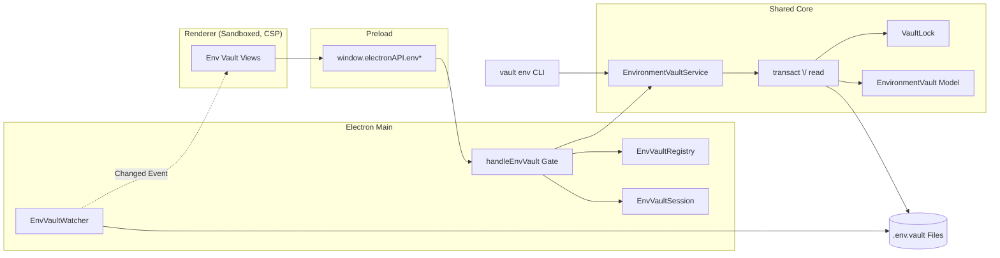
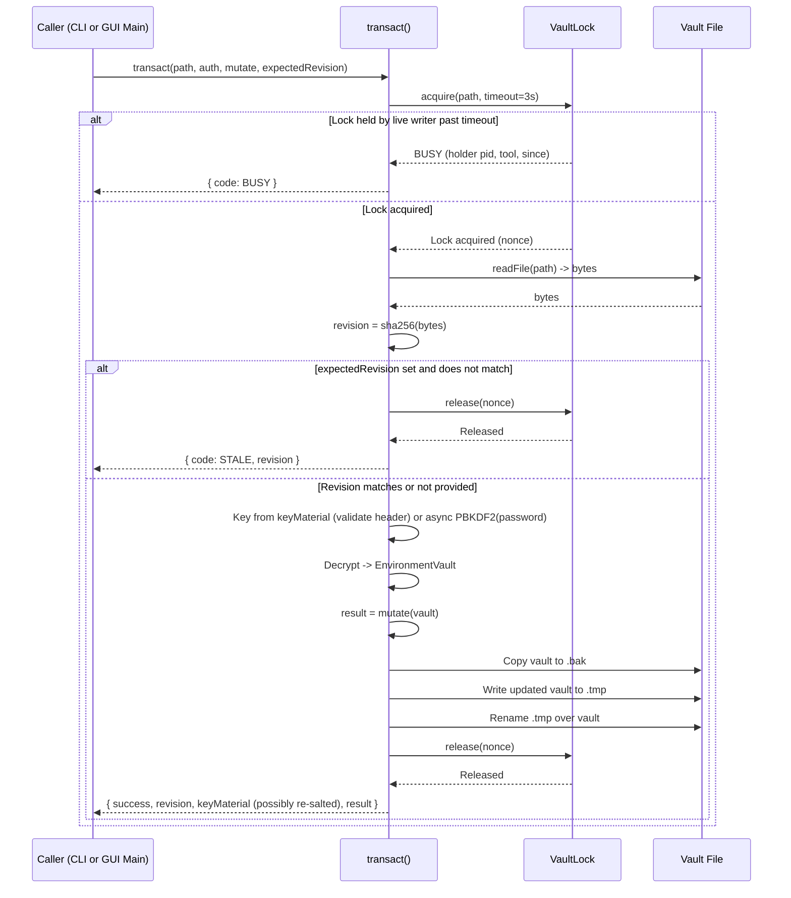
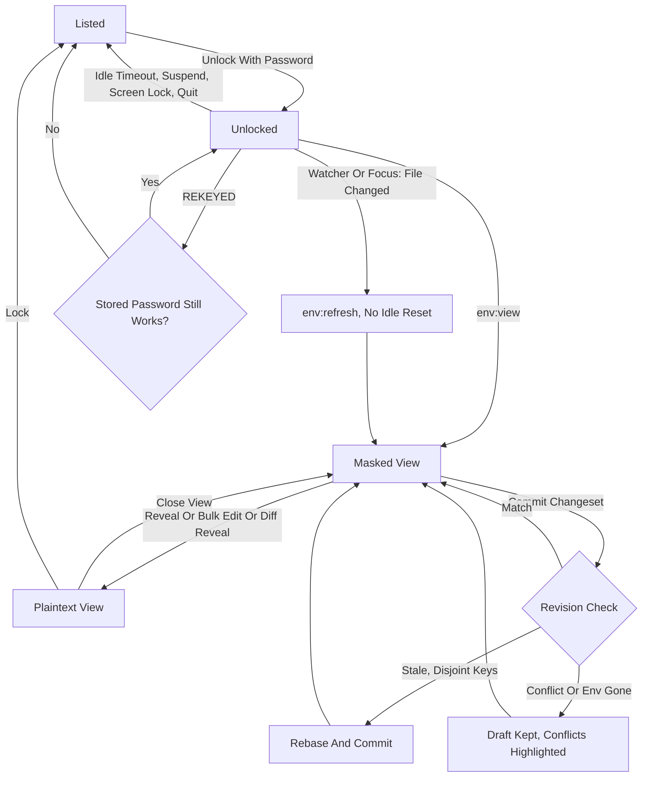

# RFC: env vaults in the desktop app

| Field     | Value                                                                                                                          |
| --------- | ------------------------------------------------------------------------------------------------------------------------------ |
| Status    | **Approved** (rev. 3, 2026-10-21): M0 and M1 can start                                                                         |
| Date      | 2026-10-21                                                                                                                     |
| Builds on | [`GUI-ENV-DISCOVERY.md`](GUI-ENV-DISCOVERY.md), [`SPEC.md`](SPEC.md), [`AGENT-DESIGN.md`](AGENT-DESIGN.md) (G23, G25, §8)      |
| Touches   | `EnvironmentVaultService` write path (CLI behavior under concurrency), Electron main/preload/renderer, renderer hardening (M0) |

## 1. Summary

The CLI is, and stays, the primary way to manage environment vaults. This RFC
adds a **second front-end in the desktop app**: everything `vault env` does
except process injection (`run`, `shell`, `agent`, `mount`, `exec`), for the
moments when browsing, comparing or bulk-editing many variables is easier to do
visually.

Project-bound commands that act on a working directory (`init --preset`,
`file`, `apply`, `clean`, `doctor`) also stay CLI-only.

The GUI is a thin transport over the same `EnvironmentVaultService` the CLI
uses. The one real change underneath it is that **every write to an env vault
now goes through a single `transact()` call** that takes a lock file, checks the
file hasn't changed since the caller read it, and writes atomically. That is
what makes "CLI and GUI open at the same time" safe, and it fixes the same race
between two CLI invocations, which exists today.

Before any env secret reaches the renderer, the renderer is hardened (M0:
`sandbox: true` and a strict CSP).

## 2. Where things stand today

Read from the code, not the docs:

| Aspect                     | Today                                                                                                         | Consequence for a GUI                                                                                 |
| -------------------------- | ------------------------------------------------------------------------------------------------------------- | ----------------------------------------------------------------------------------------------------- |
| Engine                     | `EnvironmentVaultService` static ops, each `loadVault → mutate EnvironmentVault → saveVault`                  | Every op already exists; only `bin/commands/env.js` calls them                                        |
| Write safety               | Atomic (`.tmp` + rename, `.bak`); **no check that the file is unchanged since it was read**                   | A write landing inside another writer's load→save window is silently lost                             |
| Write window               | `loadVault` derives PBKDF2 (600k, ~250 ms) between reading the file and writing it                            | The race window is ≥250 ms on every CLI write, not microseconds                                       |
| Key reuse                  | `loadVault` returns `keyMaterial`; ops reuse it for their own save, but every op re-derives on load           | A GUI calling ops directly would block the main process ~250 ms per click                             |
| Key derivation             | `CryptographyService.deriveKey` uses `crypto.pbkdf2Sync`                                                      | Blocks the event loop; `changePassword` re-keys every `.deleted.<ts>` snapshot (2 derivations each)   |
| `show` masking             | CLI prints sensitive values as `abcd****wxyz` (length > 8), else `****`                                       | The GUI is stricter (§6.7): a sensitive value never leaves main unless revealed                       |
| Inheritance                | `showEnv` returns the env's own vars; `extends` is resolved separately (`EnvironmentResolver`)                | Display and editing must say which they act on (§6.4)                                                 |
| Vault location             | `resolveVaultPath()` walks up from `cwd` (git-bounded), then `config/`, then `<appdata>/envs/<cwd>.env.vault` | The GUI has no cwd; vaults live in all four places                                                    |
| GUI session                | `VaultSession`: one password vault at a time, password + derived keys in main                                 | Can't hold env vaults; a separate session is needed                                                   |
| IPC gate                   | `handle()` (trusted sender) and `handleVault()` (`validateVaultName`)                                         | Env vaults are file paths; name validation doesn't apply                                              |
| Renderer                   | `contextIsolation: true`, `nodeIntegration: false`, **no `sandbox`, no CSP**                                  | Decrypted env values in the renderer would sit behind weaker walls than they should                   |
| CLI `$EDITOR` flow         | Loads to show the previous value, then `setEnv` reloads before writing                                        | The CLI is already "per-key op, re-read before write": the GUI should match it, not save whole models |
| Destructive-op safety nets | `deleteEnv` keeps `<vault>.deleted.<ts>`; `rollback` appends a new version copying vN; `squash` keeps nothing | Relevant to the plain-confirm decision (§11)                                                          |
| Version cap                | `addVersion` throws past 1000 versions per env (`MAX_VERSIONS`)                                               | Every GUI save adds a version; the UI must surface this and point to squash                           |

## 3. Goals and non-goals

**Goals**

1. Every **vault-scoped** `vault env` operation is reachable from the GUI and
   runs the same `EnvironmentVaultService` code as the CLI: init (without
   presets), import, set, get, show, list, rm, delete, rename, copy, extends,
   description, export, template, history, rollback, squash, diff, validate,
   change-password.
2. **No lost updates** in any direction (GUI↔CLI, CLI↔CLI, GUI↔GUI), proven by
   an automated multi-process test.
3. No vault format change: files written by the GUI open in today's CLI and
   vice versa.
4. The renderer can only address vaults the main process handed it, by opaque
   id; a forged path is rejected.
5. Values are masked by default; plaintext crosses IPC only on reveal/edit or for
   the env a diff/bulk-edit view explicitly loads, and is dropped on close or lock.
6. Env vaults, and from now on password vaults too, lock after 5 minutes
   without user activity, and on suspend, screen lock and quit.
7. An e2e scenario covers open → unlock → edit → concurrent CLI edit → reload,
   and runs in CI on every PR.

**Non-goals**

- Process injection from the GUI (`run`, `shell`, `agent`, `mount`, `exec`).
- Project-bound commands, which act on a working directory or its `.vaultrc`
  manifest and have no meaning without one: `init --preset` (scaffolds files and
  edits `.gitignore`), `file`, `apply`, `clean`, `doctor`.
- Any change to CLI commands, flags or output. (Its _concurrency_ behavior
  changes; see §8.)
- Talking to the agent. G23 (no list/dump verbs) stays intact; revisit after
  [`NATIVE-HELPER-RFC.md`](NATIVE-HELPER-RFC.md).
- Project-folder registration or cwd-style auto-discovery in the GUI.
- Team sharing, sync, or non-technical-user flows.
- Off-heap secret storage (same documented limit as `VaultSession`, AGENT-DESIGN §8).

## 4. The constraint that decides the design

A GUI holds a vault open for minutes; a CLI write takes ≥250 ms between reading
and writing the file. Any design that leaves the write path as
"load, mutate, save" lets one side silently erase the other. Checking only on
the GUI side doesn't help: the CLI would still overwrite a GUI write that lands
inside its own window.

So the fix has to live in the **one piece of code both front-ends share**, and it
has to work across processes. Everything else in this RFC is transport and UI.

## 5. Options considered

| Option                                   | Lost updates       | CLI change          | Plaintext held           | Verdict                                       |
| ---------------------------------------- | ------------------ | ------------------- | ------------------------ | --------------------------------------------- |
| S1 Thin IPC adapter over today's service | ❌ both directions | none                | per op                   | Rejected: misses goal 2 silently              |
| **S2 Transactional core + thin adapter** | ✅ all directions  | write path only     | per op                   | **Chosen**                                    |
| S3 Main holds the decrypted model        | ⚠️ GUI-side only   | none                | every env, whole session | Rejected: contradicts G25, coarse conflicts   |
| S4 GUI spawns the CLI per op             | ❌                 | `--json` everywhere | per op                   | Rejected: ~550 ms/op, packaging, buys nothing |

## 6. Proposed design

### 6.1 Architecture



New pieces: `transact`/`read` and `VaultLock` in the shared core; the registry,
session, watcher and gate in main; views in the renderer. Nothing in the
CLI's command layer changes.

### 6.2 `read()` and `transact()`

```js
// src/electron/services/EnvironmentVaultService.js

/**
 * auth: a password string (back-compat: every existing call site passes one),
 *       { password }, or { keyMaterial } from an earlier read/transact.
 */
static async read(vaultPath, auth)
// → { success: true, vault: EnvironmentVault, revision, keyMaterial }
// → { success: false, code: 'NOT_FOUND' | 'AUTH' | 'REKEYED' | 'INVALID', error }

static async transact(vaultPath, auth, mutate, {
  expectedRevision = null, // null = no staleness check (CLI default, see §6.3)
  create = false,          // allow a missing file (init)
  lockTimeoutMs = 3000,
} = {})
// mutate(vault, { revision }) → result | Promise<result>; throwing aborts, nothing is written
// → { success: true, revision, keyMaterial, result }
// → { success: false, code: 'STALE' | 'BUSY' | 'AUTH' | 'REKEYED' | 'NOT_FOUND' | 'INVALID' | 'ERROR', ... }
```

**Revision.** `revision = "sha256:" + sha256(file bytes)`. Each save uses a fresh
IV, so every write changes it. No format change. The file is read **once**,
hashed and parsed from the same buffer, so the revision always describes the
bytes that were decrypted.

**Key reuse.** `{ keyMaterial }` is only valid while the file's salt and KDF
header match the ones it was derived from. Reads and saves with valid
`keyMaterial` do no PBKDF2 at all. A write can itself change the header:
`saveVault` re-salts a vault still at the legacy work factor. So **every
successful `transact` returns the `keyMaterial` the file now uses, and callers
that cache keys must store it** together with the new revision (§6.6). If the
header no longer matches the caller's `keyMaterial`, `read`/`transact` return
`REKEYED`. That can mean another process ran the KDF upgrade (the password
still works) or changed the password (it doesn't). The GUI retries once with
its stored password and locks the vault only if that fails with `AUTH`.

**Derivation never blocks the event loop.** `CryptographyService` gains
`deriveKeyAsync` (async `crypto.pbkdf2`, which runs on libuv's thread pool), and
`read`/`transact`/`changePassword` use it. The CLI's behavior is unchanged. The
Electron main process stays responsive during unlock and change-password, and
the lock heartbeat (§6.5) can fire during long transactions.

**Reads take no lock.** Writes are atomic renames, so a reader always sees a
whole file, old or new.



Snapshots (`deleteEnv`'s `.deleted.<ts>`, `squash`'s new `.squashed.<ts>`, §12 D2, and change-password's re-key of both kinds) are taken inside `mutate`'s transaction, so they're covered by the
same lock.

### 6.3 Every existing op moves onto `transact`

Each public op keeps its signature (with `password` widened to `auth`) and its
body becomes a `mutate` callback. For example:

```js
static async renameEnv(vaultPath, auth, oldName, newName, opts = {}) {
  return this.#toLegacy(
    await this.transact(vaultPath, auth, (vault) => {
      vault.renameEnvironment(oldName, newName);
    }, opts)
  );
}
```

`#toLegacy` keeps the existing `{ success, error }` shape that the CLI parses,
adding `code` and `revision`. `saveVault` becomes private to the service.
Callers lose the ability to write without the lock. A lint rule (or a test that
greps `bin/`) keeps it that way.

**The CLI passes no `expectedRevision`.** Each CLI command is one short
transaction that reads fresh under the lock, so it can't be stale. The lock
alone stops it from clobbering a concurrent writer. The GUI always passes
`expectedRevision` (or uses changesets, §6.4).

### 6.4 Changesets: bulk edits as one transaction

Variable edits from the GUI (single key or bulk) are sent as a **changeset**:

```js
/** @typedef {Object} EnvChangeset
 * @property {string} viewId        - the view that produced it (§6.6); main maps it to env + base
 * @property {string} [message]     - history message, default "Edited in desktop app"
 * @property {Array<
 *   | { op: 'set', key: string, value: string, isPublic?: boolean, isRequired?: boolean }
 *   | { op: 'rm',  key: string }
 *   | { op: 'meta', key: string, isPublic?: boolean, isRequired?: boolean }
 * >} ops
 */
```

The renderer never sends a base revision or prior values. Main keeps them in
the view record (§6.6), as **hashes only**:

- `envIdentity = name + "\0" + versions[0].created`. This survives edits but
  not a delete/re-create or a rename.
- `keyStamps: Map<key, sha256(value + "\0" + sensitive + "\0" + required)>`, over
  the env's **own** active-version vars. A concurrent `--public` or
  `--required` change counts as a change, not just a new value.

**Inheritance.** Views display the resolved env (`EnvironmentResolver`), and each
inherited key is marked `inheritedFrom: <parent>`. Stamps, ops and conflicts
only ever concern the env's own vars. Editing an inherited key adds an override
to this env and never touches the parent. A change to the parent never
conflicts with a child's draft; the refreshed view just shows the new inherited
value.

**Text mode.** The dotenv editor (§6.9) is turned into ops by diffing the
edited text against the view's **base**, never against the fresh vault. A key
the user didn't touch produces no op, so a concurrent CLI change to it
survives.

Applying a changeset:

1. `transact` with `expectedRevision = view.baseRevision`.
2. If `STALE`: `read` the fresh vault and check the preconditions:
   - the env still exists with the same `envIdentity`. Otherwise return
     `CONFLICT` with `kind: 'env-gone'`;
   - for every key the changeset touches, the fresh stamp equals
     `view.keyStamps` (absent on both sides counts as equal).
     If both hold, rerun `transact` against the fresh revision (a **rebase**).
     This retries at most once, then gives up as `STALE`.
3. If any touched key's stamp differs: return
   `{ code: 'CONFLICT', conflicts: [{ key, kind: 'changed' | 'removed' | 'added' }] }`.
   The renderer keeps the draft, refreshes the base view, highlights the
   conflicting keys and lets the user re-apply. No merge UI in v1.
4. All ops land as **one** new version via a new model method
   `EnvironmentVault.applyVarChanges(env, ops, { message, createEnv = false })`.
   It **never creates a missing env unless `createEnv` is set**. Only the
   CLI's `set` (which today auto-creates the env) and `import` pass it.
   Changesets never do, so a draft can't bring back an env deleted or renamed
   meanwhile. `setEnv`, `removeKey` and `importEnvFile` are re-implemented on
   it, so CLI and GUI produce identical history.
5. If the env is at `MAX_VERSIONS` (1000), the model throws as today. The GUI
   maps this to `code: 'LIMIT'` and offers squash.

```mermaid
sequenceDiagram
    participant R as Renderer
    participant M as Main (Gate + Session)
    participant TX as transact()
    participant CLI as CLI (Other Process)

    R->>M: env:view(id, "dev")
    M->>TX: read(keyMaterial)
    TX-->>M: Vault data + revision
    M-->>R: viewId + masked vars
    Note over M: Keep baseRevision + envIdentity + keyStamps for the view

    CLI->>TX: setEnv(dev, DB_URL) under lock
    TX-->>CLI: Success + new revision
    Note over M: Watcher detects env-vault-changed
    M-->>R: Show banner: Updated by another tool

    R->>M: env:commit(id, changeset)
    M->>TX: transact(expectedRevision = baseRevision)
    TX-->>M: STALE + current revision

    M->>TX: Read fresh vault + revision
    TX-->>M: Fresh vault data + revision
    M->>M: Check envIdentity, then touched key stamps against base

    alt Env deleted or renamed meanwhile
        M-->>R: CONFLICT (env-gone), draft kept
    else Disjoint keys changed
        M->>TX: transact(expectedRevision = freshRevision)
        TX-->>M: Success + new revision + keyMaterial
        M->>M: session.commit(revision, keyMaterial); new view base
        M-->>R: Success, rebased = true, revision
    else Overlapping key changed
        M->>M: Identify conflicting keys
        M-->>R: CONFLICT + conflicts
        Note over R: Preserve draft for user resolution
    end
```

Structural ops (create/rename/copy/delete env, extends, description, rollback,
squash, change-password, init) are **not** rebased. They carry
`expectedRevision`. On `STALE` the GUI reloads and the user repeats the action.

### 6.5 The lock file

`<vault>.lock`, created with exclusive create (`fs.open(path, 'wx', 0o600)`):

```json
{
  "v": 1,
  "pid": 41237,
  "host": "wael-mbp",
  "tool": "cli",
  "nonce": "9f2c…",
  "boot": "2026-10-20T08:14Z",
  "acquiredAt": "2026-10-21T17:02:11.410Z",
  "refreshedAt": "2026-10-21T17:02:11.410Z"
}
```

`boot` is the machine's boot time to the minute (`Date.now() - os.uptime()`).
Together with `pid` it identifies a live process on **this** machine even when
macOS renames the host on a network change. `host` is kept for messages only.

| Rule       | Behavior                                                                                                                                                                                                                                                  |
| ---------- | --------------------------------------------------------------------------------------------------------------------------------------------------------------------------------------------------------------------------------------------------------- |
| Acquire    | `wx` create. On `EEXIST`, retry with backoff (50 → 100 → 200 → 400 ms, capped) for up to `lockTimeoutMs` (3 s)                                                                                                                                            |
| Heartbeat  | While held, the holder rewrites `refreshedAt` every 5 s (the event loop is free because derivation is async, §6.2). A long `changePassword` (2 derivations per snapshot) keeps its lock                                                                   |
| Stale      | **Same machine** (`boot` within ±1 min): stale **only** if `process.kill(pid, 0)` throws `ESRCH`. A live holder is never taken over, however long it runs. **Other machine** (synced folder): stale if `refreshedAt` is older than `STALE_LOCK_MS` (30 s) |
| Takeover   | `rename(lock, lock + '.stale.' + ourNonce)` (atomic, so only one taker wins), delete the renamed file, retry `wx`                                                                                                                                         |
| Release    | In `finally`: read the lock, unlink **only if the nonce is ours**. Read-then-unlink isn't atomic, but a live holder's lock is never taken over, so nothing can replace it in between                                                                      |
| PID reuse  | A dead holder whose pid was reused keeps the lock looking live; callers get `BUSY` naming the pid, and `doctor` flags a lock whose pid isn't a `vault`/app process                                                                                        |
| Give up    | `BUSY`: _"Vault is busy (held by cli pid 41237 since 17:02:11). Try again, or remove `<path>.lock` if no vault command is running."_                                                                                                                      |
| Never held | Across user think time: the CLI's `$EDITOR` and `--value-stdin` waits happen **before** `setEnv`'s transaction; the GUI never holds the lock outside a single IPC call                                                                                    |

### 6.6 Main process

**`EnvVaultRegistry`**, the only source of paths:

```js
class EnvVaultRegistry {
  list()                      // scan <appdata>/envs/*.env.vault + recents → [{ id, label, location, source, exists }]
  async openFromDialog(win)   // native picker (filters: *.env.vault, .env.vault); validates type === 'environment-vault' → { id }
  async createFromDialog(win) // save dialog (default name .env.vault) → { id, path } for init
  createInAppData(name)       // name validated like validateVaultName → { id, path }
  resolve(id)                 // → path | null   (the ONLY id → path mapping)
  forget(id)                  // drop from recents (file untouched)
}
```

- Ids are random 128-bit hex, minted per app run, never derived from the path.
- Recents persist in `<appdata>/gui-env-recents.json` (`0600`):
  `[{ "path": "...", "lastOpened": "..." }]`. Paths only, written only by main.
  A missing file shows as "missing" with a Forget action. A Settings toggle (on
  by default) stops remembering paths and clears the list (§12 D5).

**`EnvVaultSession`**, keyed by vault id:

```js
class EnvVaultSession {
  async unlock(id, password)  // read(path, { password }) → store { password, keyMaterial, revision }
  auth(id)                    // { keyMaterial }
  commit(id, { revision, keyMaterial }) // after EVERY successful read/transact: the key may have been re-salted (§6.2)
  async recover(id)           // on REKEYED: re-derive from the stored password; AUTH → lock(id)
  lock(id) / lockAll()        // zero cached key Buffers, drop views, emit env-vault-locked
  touch(id)                   // idle timer reset, called by user-initiated channels only
}
```

Several env vaults may be unlocked at once. Each locks after **5 minutes**
without user activity (configurable in Settings). Password vaults get the same
idle lock, which they lack today (§12 D1). **Only user-initiated channels reset the idle timer.** Refetches
triggered by the watcher or by window focus go through `env:refresh` (§6.7),
which doesn't call `touch`, so a vault the CLI keeps writing still idles out.
`lockAll()` hooks into the existing `setupAutoLock` (suspend, lock-screen,
`before-quit`). After a successful `changePassword`, the session replaces the
stored password and key.

**Views**, created by `env:view` / `env:bulk-load` / `env:diff`:
`{ viewId, id, env, baseRevision, envIdentity, keyStamps, plaintext: boolean }`
(§6.4). Dropped on `env:view-close`, on lock, and on the next `env:view` for
the same window and env.

**`EnvVaultWatcher`** watches the vault's **directory** (`fs.watch(dir)`),
because atomic rename replaces the inode (same lesson as
`src/agent/mountWatch.js`). Events are filtered by basename. An event with no
filename (some platforms send `null`) is treated as possibly the vault's. It
debounces 150 ms, then hashes the file. If the revision differs from the
session's last committed revision, it emits `env-vault-changed { id, revision }`.
It runs only while the vault is unlocked.

**Single instance.** The app calls `app.requestSingleInstanceLock()` (it doesn't
today), so only one process owns the sessions and the recents file. A second
launch focuses the existing window. Vault writes would be safe without it
(§6.2); recents writes and duplicate sessions wouldn't.

### 6.7 IPC interface

All channels go through a new gate, which wraps the existing trusted-sender check:

```js
const handleEnvVault = (channel, fn) =>
  handle(channel, (event, id, ...args) => {
    const path = this.envRegistry.resolve(id);
    if (!path)
      return { success: false, code: 'INVALID', error: 'Unknown vault' };
    return fn(event, { id, path }, ...args);
  });
```

| Channel                                                                                      | Args (after `id`)                                           | Returns (on success)                                                                     | Plaintext?             |
| -------------------------------------------------------------------------------------------- | ----------------------------------------------------------- | ---------------------------------------------------------------------------------------- | ---------------------- |
| `env-vaults:list`¹                                                                           | —                                                           | `[{ id, label, location, source, exists, unlocked }]`                                    | no                     |
| `env-vaults:open`¹                                                                           | —                                                           | `{ id }` (native dialog)                                                                 | no                     |
| `env-vaults:create`¹                                                                         | `{ mode: 'appdata', name } \| { mode: 'dialog' }, password` | `{ id }` (runs `init`)                                                                   | no                     |
| `env-vaults:forget`                                                                          | —                                                           | `{}`                                                                                     | no                     |
| `env-vault:unlock`                                                                           | `password`                                                  | `{ revision }`                                                                           | no                     |
| `env-vault:lock`                                                                             | —                                                           | `{}`                                                                                     | no                     |
| `env-vault:change-password`                                                                  | `current, next`                                             | `{ revision }`                                                                           | no                     |
| `env:list`                                                                                   | —                                                           | `[{ name, description, extends, varCount, activeVersion, versionCount }]`                | no                     |
| `env:view`                                                                                   | `env`                                                       | `{ viewId, revision, vars: [{ key, sensitive, required, inheritedFrom, value? }] }`²     | non-sensitive only     |
| `env:refresh`                                                                                | `viewId`                                                    | same as `env:view`, new base for the same view; **does not reset the idle timer**        | non-sensitive only     |
| `env:reveal`                                                                                 | `viewId, key`                                               | `{ value }`                                                                              | **one value**          |
| `env:copy`                                                                                   | `viewId, key`                                               | `{}`: main's `ClipboardService` writes it and clears it after 30 s if unchanged (§12 D6) | no (never crosses IPC) |
| `env:bulk-load`                                                                              | `env`                                                       | `{ viewId, revision, vars: [{ key, value, … }] }`                                        | **whole env**          |
| `env:view-close`                                                                             | `viewId`                                                    | `{}`                                                                                     | —                      |
| `env:commit`                                                                                 | `changeset`                                                 | `{ revision, rebased }` · `CONFLICT` · `STALE`                                           | no                     |
| `env:create` / `env:delete` / `env:rename` / `env:copy-env` / `env:extends` / `env:describe` | op args, `expectedRevision`                                 | `{ revision }` · `STALE`                                                                 | no                     |
| `env:history`                                                                                | `env`                                                       | `[{ n, created, message, keyCount, active }]`                                            | no                     |
| `env:rollback` / `env:squash`                                                                | `env, n \| keep, expectedRevision`                          | `{ revision }` · `STALE`                                                                 | no                     |
| `env:diff`                                                                                   | `envA, envB, { reveal }`                                    | `{ viewId?, added, removed, changed, same }` (values only when `reveal`)                 | only if `reveal`       |
| `env:validate`                                                                               | `env`                                                       | `{ issues: [...] }`                                                                      | no                     |
| `env:import`                                                                                 | `env`                                                       | `{ revision, imported }` (main shows the open dialog and reads the `.env`)               | no                     |
| `env:export` / `env:template`                                                                | `env, format`                                               | `{ path }` (main shows a save dialog and writes the file `0600`)                         | no (never crosses IPC) |

¹ No `id` argument; plain `handle`. ² `value` is present only for keys in the
version's `nonSensitive` list. This is **stricter than the CLI's `show`**, which
prints sensitive values as `abcd****wxyz`. The GUI shows sensitive values as
dots, and no part of a sensitive value leaves main until it is revealed.
`inheritedFrom` is set for keys resolved from a parent env (§6.4).

Events (main → renderer): `env-vault-changed { id, revision }`,
`env-vault-locked { id }`.

Error shape everywhere: `{ success: false, code, error }`, where `code` is one of
`LOCKED · STALE · CONFLICT · BUSY · LIMIT · AUTH · NOT_FOUND · INVALID · ERROR`.
`REKEYED` never reaches the renderer: main resolves it with `session.recover`
(§6.6) and either retries the call or reports `LOCKED`.

### 6.8 Session lifecycle



### 6.9 Renderer

- The vault selector gets a **Passwords | Environments** switch (§12 D4). The
  Environments side lists `env-vaults:list` entries, with Open… and New…
  (New = `init` without presets).
- Env vault screen: env list (left), selected env's variables (right) as a table
  with masked values, a Reveal toggle per row, Copy, and inline edit (a
  one-op changeset). Inherited keys are shown dimmed with "from `<parent>`";
  editing one creates an override in this env (§6.4).
- **Bulk edit** mode: `env:bulk-load`, then either the table or a dotenv text
  editor (mirroring `$EDITOR`). Save sends one changeset, computed against the
  view's base (§6.4). Leaving the mode calls `env:view-close` and clears
  component state.
- A `CONFLICT` with `env-gone` says the env was deleted or renamed elsewhere and
  offers to copy the draft as dotenv text, so it isn't lost. A `LIMIT` error
  offers squash.
- History, Diff (masked by default, "Show values" re-requests with
  `reveal: true`), Validate, Import/Export/Template, and env actions in menus.
- Destructive actions (delete env, rollback, squash, change-password) use a
  plain confirm dialog (§11). Change-password asks for the current and new
  passwords because the operation needs them.
- On `env-vault-changed` or window focus: `env:refresh` the view and show
  "Updated by another tool" if the revision moved.
  On `env-vault-locked`: drop all state for that id and return to the list.

### 6.10 M0: renderer hardening

- `webPreferences.sandbox: true`. The preload only uses `contextBridge` and
  `ipcRenderer`, which sandboxed preloads support.
- A CSP `<meta>` in `index.html` (production is loaded from `file://`):
  `default-src 'self'; script-src 'self'; style-src 'self' 'unsafe-inline'; img-src 'self' data:; connect-src 'self'; object-src 'none'; base-uri 'none'; frame-ancestors 'none'`.
  `'unsafe-inline'` for styles is needed by emotion/MUI; dev mode adds
  `ws://localhost:3000` for Vite HMR.
- This ships on its own and benefits password vaults too.

## 7. Data schema

- **Vault file:** unchanged
  (`{ type: 'environment-vault', version: 1, salt, kdf, iv, authTag, encrypted }`).
- **Decrypted model:** unchanged. `applyVarChanges` is a new method, not a new
  field. Env identity (§6.4) is derived from the existing `versions[0].created`.
- **New files:** `<vault>.lock` (transient, §6.5) and
  `<appdata>/gui-env-recents.json` (§6.6).

## 8. CLI impact

No command, flag or output changes. Behavior changes only under concurrency:

| Situation                             | Before                  | After                                                                                                                                            |
| ------------------------------------- | ----------------------- | ------------------------------------------------------------------------------------------------------------------------------------------------ |
| Two writers overlap                   | Last one wins, silently | Second waits ≤3 s, then `BUSY` with the holder's pid                                                                                             |
| CLI crashed mid-write                 | Nothing left behind     | A `.lock` is left; the next writer sees its pid is dead and takes it over (§6.5)                                                                 |
| `change-password` with many snapshots | Blocks for N × ~0.5 s   | Same duration, but derivation is async and the lock heartbeat keeps the lock held (§6.2, §6.5)                                                   |
| `squash`                              | Keeps nothing           | Writes `<vault>.squashed.<ts>` first; `change-password` re-keys it along with `.deleted.<ts>` (§12 D2)                                           |
| `set` on an env that doesn't exist    | Creates the env         | Unchanged (`set` and `import` pass `createEnv`); only GUI changesets refuse to create (§6.4)                                                     |
| Mixed versions: pre-RFC CLI + new GUI | —                       | The old CLI takes no lock and can still clobber; the GUI's revision check still protects the GUI's own writes. **Upgrade the CLI with the app.** |

The CHANGELOG and `docs/guide/cli/env-vaults.md` get a "Concurrent writes" note.
`vault env doctor` reports a stale lock.

## 9. Testing

The suite uses the existing `fastKdf` helper. It reaches spawned CLI processes
through `NODE_OPTIONS=--import` (`vite.config.js` `test.env`), so the
multi-process tests don't pay 600k-iteration PBKDF2.

| Layer                    | What it proves                                                                                                                                                                                                                                                                           | Where                                                  |
| ------------------------ | ---------------------------------------------------------------------------------------------------------------------------------------------------------------------------------------------------------------------------------------------------------------------------------------- | ------------------------------------------------------ |
| `VaultLock` unit         | Acquire/backoff/`BUSY`; same-machine takeover **only** when the pid is dead; a live holder past 30 s is never taken over; foreign-`boot` lock taken after a stale `refreshedAt`; heartbeat; nonce-checked release; two takers race → one wins                                            | `src/__tests__/electron/services/VaultLock.test.js`    |
| No lost updates (goal 2) | 2 spawned CLI processes × 50 `set`s of distinct keys on one vault, plus an in-process `transact` loop → all 100+ keys present, history strictly increasing                                                                                                                               | `src/__tests__/cli/envConcurrency.integration.test.js` |
| `transact` / `read`      | `STALE` on a mismatched revision; `REKEYED` on a re-salted header; returned `keyMaterial` reflects a KDF upgrade; `mutate` throwing writes nothing; snapshots (`.deleted`, `.squashed`) taken inside the lock and re-keyed by change-password                                            | `EnvironmentVaultService.test.js`                      |
| Changeset rebase matrix  | Disjoint keys → rebased; same key changed → `CONFLICT changed`; flag-only change → conflict; key removed/added → conflict; env deleted → `env-gone`; env renamed → `env-gone`; env rolled back → per-key result; parent env changed → no conflict; text mode leaves untouched keys alone | `EnvironmentVaultService.changeset.test.js`            |
| Model                    | `applyVarChanges` = one version; refuses a missing env without `createEnv`; `LIMIT` at `MAX_VERSIONS`                                                                                                                                                                                    | `src/__tests__/electron/models/`                       |
| IPC boundary             | A path string, an unknown id or another window's id → `INVALID`; untrusted sender refused; `env:copy`/`env:export` never return a value; sensitive values absent from `env:view`/`env:refresh`                                                                                           | main-process contract tests (M3)                       |
| Session                  | Idle lock (env and password vaults) fires despite `env:refresh` traffic; `lockAll` on suspend/lock-screen; `REKEYED` → recover or lock; change-password updates the stored password                                                                                                      | `EnvVaultSession.test.js`                              |
| Watcher                  | Fires after atomic rename (new inode); ignores own commits; handles a `null` filename                                                                                                                                                                                                    | `EnvVaultWatcher.test.js`                              |
| CLI regression           | Every existing `src/__tests__/cli/env*.integration.test.js` passes unchanged (goal 3)                                                                                                                                                                                                    | existing                                               |
| e2e (goal 7)             | Seed → open from appdata → unlock → edit → `vault env set` from the scenario → banner + refreshed value → commit a disjoint draft (rebased) → commit an overlapping one (conflict)                                                                                                       | `e2e/scenarios/env-vault-concurrent.cjs`, in CI        |

## 10. Milestones

| #      | Deliverable                                                                                                                                                                                                                                                                          | Ships alone?                  |
| ------ | ------------------------------------------------------------------------------------------------------------------------------------------------------------------------------------------------------------------------------------------------------------------------------------ | ----------------------------- |
| **M0** | Renderer `sandbox: true` + CSP; e2e still green                                                                                                                                                                                                                                      | yes                           |
| **M1** | `VaultLock` (`boot` identity, heartbeat), `read`, `transact`, `auth` union, returned `keyMaterial`, `REKEYED`, async `deriveKeyAsync`; every op ported; `squash` snapshot + re-key of `.squashed.<ts>`; `saveVault` private; multi-process no-lost-update test; CLI docs + `doctor`  | yes (CLI benefits on its own) |
| **M2** | `applyVarChanges` (`createEnv`, `LIMIT`), changeset apply + rebase (env identity, key stamps) in the service; `setEnv`/`removeKey`/`importEnvFile` on it                                                                                                                             | yes                           |
| **M3** | Main: single-instance lock, 5-min idle lock for env **and password** vaults, `ClipboardService`, registry, session (`commit`/`recover`, user-only idle reset, `lockAll` hooks), watcher, `handleEnvVault`, all channels incl. `env:refresh` + preload; id-forgery and contract tests | behind the UI                 |
| **M4** | Renderer: Environments switch, list/open/create/unlock, env view, reveal/copy, inline + bulk edit, live reload, conflict banner; password-entry copy moved to `ClipboardService`                                                                                                     | **first user-visible**        |
| **M5** | Renderer: env structure ops, history/rollback/squash, diff, validate, import/export/template, change-password                                                                                                                                                                        | yes                           |
| **M6** | e2e scenario `env-vault-concurrent.cjs`; CI e2e job (ubuntu + xvfb); `docs/guide/gui/env-vaults.md`                                                                                                                                                                                  | yes                           |

M0 and M1 can run in parallel. M2 depends on M1, M3 on M2, and M4 on M3 and M0.

## 11. Risk analysis

**Failure modes**

| Risk                                                      | Likelihood | Impact | Mitigation                                                                                                                                                                                                                                                                                 |
| --------------------------------------------------------- | ---------- | ------ | ------------------------------------------------------------------------------------------------------------------------------------------------------------------------------------------------------------------------------------------------------------------------------------------ |
| Crash leaves `<vault>.lock`                               | Medium     | Low    | Same machine: taken over as soon as its pid is dead; `doctor` reports it; the `BUSY` message names the file                                                                                                                                                                                |
| Vault in an iCloud/Dropbox/NFS folder                     | Medium     | Medium | `wx` isn't reliable on NFS; sync tools replicate `.lock` (different `boot` → taken over only after `refreshedAt` is 30 s stale; the heartbeat keeps a live remote holder's lock). The revision check still catches local races. Documented as unsupported for concurrent multi-machine use |
| Windows `rename` `EPERM` while a reader has the file open | Low        | Low    | Bounded retry (3× / 50 ms) around the final rename                                                                                                                                                                                                                                         |
| Env deleted or renamed while a GUI draft is open          | Low        | Medium | Env identity check → `CONFLICT env-gone`; `applyVarChanges` never auto-creates for changesets; the draft can be copied out (§6.4, §6.9)                                                                                                                                                    |
| Long transaction (change-password, many snapshots)        | Low        | High   | Same-machine live holders are never taken over; the heartbeat covers remote holders; derivation is async (§6.2, §6.5)                                                                                                                                                                      |
| Rebase loop under heavy concurrent writes                 | Very low   | Low    | One rebase attempt, then `STALE` back to the user                                                                                                                                                                                                                                          |
| Old CLI without locking (mixed versions)                  | Medium     | High   | §8: release together, CHANGELOG callout; the GUI's revision check still guards its own writes                                                                                                                                                                                              |
| Watcher misses an event (platform quirks)                 | Low        | Low    | Every commit carries a revision anyway; the view also refetches on window focus                                                                                                                                                                                                            |

**Security**

| Risk                                                            | Mitigation                                                                                                                                                                                                                                   |
| --------------------------------------------------------------- | -------------------------------------------------------------------------------------------------------------------------------------------------------------------------------------------------------------------------------------------- |
| Renderer compromise reads revealed values                       | M0 sandbox + CSP; masked by default; copy and export never cross IPC; views dropped on close/lock. **Residual:** a compromised renderer can call `env:bulk-load` on an unlocked vault, same as it can drive an unlocked password vault today |
| Renderer points main at arbitrary files                         | Only main mints ids; `handleEnvVault` rejects unknown ids; dialogs run in main; tested in M3                                                                                                                                                 |
| Plaintext lingers in JS heap (main and renderer)                | Same documented limit as `VaultSession` (AGENT-DESIGN §8); key Buffers zeroed on lock                                                                                                                                                        |
| Recents file leaks project paths                                | Paths only, `0600`, same exposure as shell history; a Settings toggle turns it off and clears it (§12 D5)                                                                                                                                    |
| Plain confirm on destructive ops (differs from C5 delete-vault) | Accepted. `deleteEnv` keeps `.deleted.<ts>`; `rollback` is reversible; `squash` keeps `.squashed.<ts>` (§12 D2)                                                                                                                              |
| Clipboard holds a secret                                        | Main's `ClipboardService` clears it after 30 s if unchanged, for env values **and** password entries (§12 D6); still visible to clipboard managers (documented)                                                                              |

**Performance**

- Unlock pays one PBKDF2 (~250 ms), now on libuv's thread pool, so the main process stays responsive. Afterwards every
  read/write reuses `keyMaterial`, so there is no PBKDF2 per click.
- Hashing the file per transaction and watcher event: vaults are KB–low-MB, so
  under 5 ms.
- `change-password` costs ~0.5 s per `.deleted.<ts>` snapshot (unchanged), off the main thread.
- The lock adds one `open`/`unlink` per write, plus a heartbeat write every 5 s while a transaction is held. Contention waits are bounded at 3 s.

## 12. Decisions on the open questions

Decided 2026-10-21, after review.

| #   | Question                       | Decision                                                                                                                                                                                                                     | Lands in |
| --- | ------------------------------ | ---------------------------------------------------------------------------------------------------------------------------------------------------------------------------------------------------------------------------- | -------- |
| D1  | Idle timeout                   | **5 minutes without user activity, for env and password vaults**, configurable in Settings. Several env vaults may be unlocked at once. Password vaults gain an idle lock they don't have today                              | M3       |
| D2  | Squash safety net              | **Snapshot first**: `squash` writes `<vault>.squashed.<ts>`, in the CLI too. `change-password` re-keys `.squashed.*` along with `.deleted.*`, so a retired password opens neither (same rule as the `.bak` fix in `1417497`) | M1       |
| D3  | e2e in CI                      | **Linux + xvfb job** on every PR, running all `e2e/scenarios`, including `env-vault-concurrent`                                                                                                                              | M6       |
| D4  | Navigation                     | **Passwords \| Environments switch** on the vault selector (§6.9)                                                                                                                                                            | M4       |
| D5  | Recents                        | **On by default, with a Settings toggle** that stops remembering paths and clears the list                                                                                                                                   | M3/M4    |
| D6  | Clipboard for password entries | **Same mechanism**: one main-side `ClipboardService` (write + 30 s clear if unchanged) for env values and password entries; the renderer's `navigator.clipboard` calls for secrets go away                                   | M3/M4    |

## 13. Decision

**Approved** on 2026-10-21. The direction (S2) and the constraints in §3–§6 were agreed in
the RFC's converge step. The review's 14 findings are addressed (rev. 2), and
every open question is decided (§12). M0 and M1 start now, in parallel.
