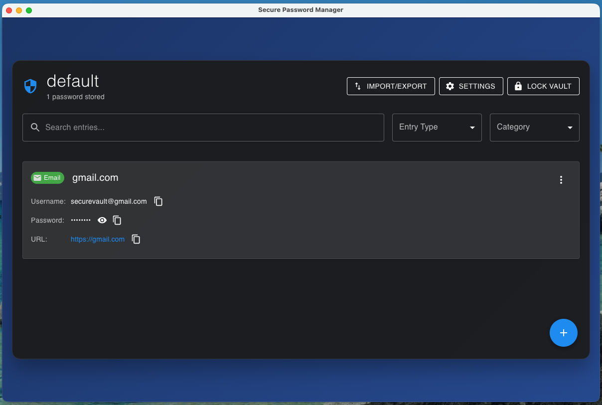
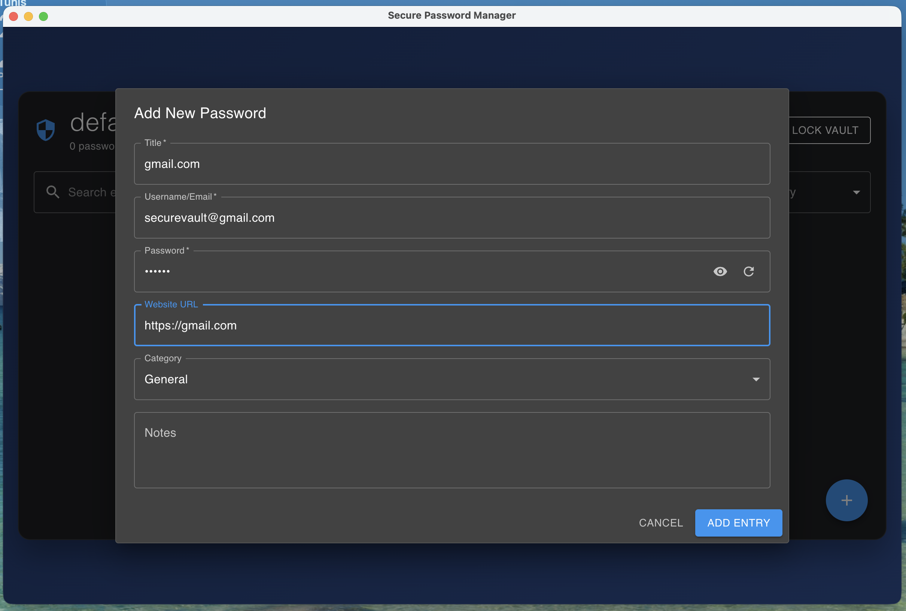

# Desktop app — install & first vault

The SecureVault desktop app is a cross-platform password manager (macOS, Windows,
Linux) built on Electron. It stores your logins in encrypted vaults and shares
those vaults with the [CLI](/guide/cli/).

  
  

## Install

Download the build for your platform from the
[**Releases page**](https://github.com/benzid-wael/secure-vault/releases/latest):

| OS          | Download                                         |
| ----------- | ------------------------------------------------ |
| **macOS**   | `.dmg` (installer) or `.zip` (portable)          |
| **Windows** | `*-Setup.exe` (installer) or portable `.exe`     |
| **Linux**   | `.AppImage` (portable) or `.deb` (Debian/Ubuntu) |

::: warning First launch on an unsigned build
The app is not yet code-signed, so your OS will warn that the developer is
unidentified — this is expected.

- **macOS** — right-click the app → **Open** → **Open** (first time only), or run
  `xattr -dr com.apple.quarantine "/Applications/Secure Password Manager.app"`.
- **Windows** — click **More info** → **Run anyway** on the SmartScreen prompt.
- **Linux (AppImage)** — `chmod +x Secure*.AppImage`, then run it.
  :::

## First-time setup

1. Launch the application.
2. Click **Create Your First Vault**.
3. Name it and choose a strong master password. There is no built-in vault or
   default password: every vault starts with a password you chose.

::: warning Upgrading from an earlier version
Earlier versions created a `default` vault with the password `changeme123`. If
you still have one, the app warns after you unlock it; use **Change password**
to set your own. The vault is otherwise unchanged.
:::

## Create a new vault

1. Click **Create New Vault** from the main screen.
2. Enter a unique vault name.
3. Create a strong master password — the app shows a live **password-strength**
   meter as you type.
4. Confirm your password.
5. Click **Create Vault**.

::: tip Your master password is never stored, unless you ask
SecureVault is zero-knowledge. If you forget the master password, the vault cannot
be recovered — choose something long, unique, and memorable. The app keeps it only
if you tick **Remember on this computer** when unlocking (below).
:::

## Unlock a vault

Select the vault in the vault selector and enter its master password. The vault
stays unlocked until you lock it, quit, or step away: it locks automatically
when your computer sleeps or its screen locks.

Tick **Remember on this computer** to keep the password, encrypted by the system
keychain. Next time, clicking the vault unlocks it straight away, after Touch ID
on a Mac that has it. Anyone using your account on this computer can then open
the vault in the app, so leave it off on a shared account. The box is offered
only where the system keychain can encrypt it (on Linux, a keyring such as GNOME
Keyring or KWallet must be running).

A vault with a saved password is labeled **Password saved**. To drop it, unlock the
vault and click **Forget saved password** in its header: as with environment vaults,
only someone who can open the vault can change how it opens. If the password was changed elsewhere, the saved one
stops working: the app forgets it and asks you to type the new one. Changing the
password in the app updates the saved one, and deleting the vault forgets it.
**Forget all saved passwords** in Settings drops every saved password, for every
vault.

## Open a vault from another folder

Vaults you create live in the app's own folder. To use one kept elsewhere (a
shared drive, a USB stick, a project folder), click **Open…** in the vault list
and pick its `.vault` file. It's listed under its file name, shows where it lives,
and works like any other vault: it's unlocked, saved and backed up in place (the
backup sits next to it as `<file>.backup`). The list is kept across restarts.

A vault opened this way is never deleted by the app: **Remove from list** (the
icon on its card) takes it off the list and forgets its saved password, and the
file stays where it is. If the file is moved or deleted, the vault shows as
**Missing** until you remove it. Environment vaults can't be opened here; open
them under **Environments**.

## Next

- [**Managing passwords**](/guide/gui/managing-passwords) — add, search, copy, edit, delete.
- [**Environment vaults**](/guide/gui/env-vaults) — the `.env` vaults the CLI uses, in the app.
- [**Security & best practices**](/guide/gui/security) — how encryption works and how to stay safe.
